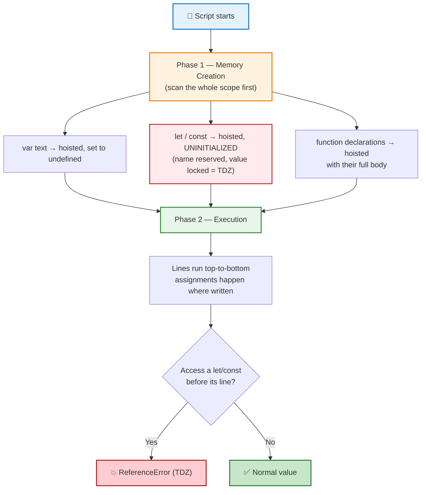

# JavaScript Hoisting & the Temporal Dead Zone (TDZ)

**What it is**
**Hoisting** is JavaScript's *two-phase* behaviour. Before a single line of your script runs, the engine scans the current scope and **reserves** every declaration it finds. What that reservation *contains* depends on the keyword:

- `var` → reserved **and** initialized to `undefined`.
- `let` / `const` / `class` → reserved but **left uninitialized**.
- `function` declarations → reserved **with their full body**, ready to call.

The gap between "the name is reserved" and "the name is initialized" is the **Temporal Dead Zone (TDZ)**. Touching a `let`/`const` name inside that gap throws a `ReferenceError` — it is *not* `undefined`.

---

## Breakdown Table

| Aspect | `var` | `let` | `const` |
|---|---|---|---|
| **Scope** | Function | Block `{ }` | Block `{ }` |
| **Hoisted?** | ✅ Yes | ✅ Yes | ✅ Yes |
| **Value *before* its declaration line** | `undefined` | ❌ TDZ → `ReferenceError` | ❌ TDZ → `ReferenceError` |
| **Can reassign?** | ✅ Yes | ✅ Yes | ❌ No |
| **Can redeclare in same scope?** | ✅ Yes | ❌ No | ❌ No |
| **Must be initialized on the declaration line?** | ❌ No | ❌ No | ✅ Yes |
| **Added to global `window`?** (top-level) | ✅ Yes | ❌ No | ❌ No |

### Hoisting vs TDZ — the two different failures

| Situation | What the engine did | What you get |
|---|---|---|
| `console.log(x)` before `var x = 1;` | Hoisted + set to `undefined` | `undefined` |
| `console.log(x)` before `let x = 1;` | Hoisted, still **uninitialized** | `ReferenceError` (TDZ) |
| `console.log(x)` before `const x = 1;` | Hoisted, still **uninitialized** | `ReferenceError` (TDZ) |
| `sayHi()` before `function sayHi(){}` | Hoisted **with the body** | Works normally |
| `sayHi()` before `var sayHi = function(){}` | Hoisted as `undefined` | `TypeError: sayHi is not a function` |

---

## Example Walkthrough

### Part A — `var` inside a function: hoisting + shadowing

From `10_JS_Functions/06_JS_Hoisting/JS_Hoisting_Const_Sample.js`:

```js
var text = "outside";   // outer (global) variable

function logIt() {
  console.log(text);    // ← prints undefined, NOT "outside"
  var text = "inside";  // declaration hoisted; assignment stays on this line
}

logIt();                // undefined
```

**Step by step:**

1. **Phase 1 (memory).** The engine sees `var text = "inside"` inside `logIt`. It hoists *only the declaration* to the top of the function — so `logIt` gets its **own** local `text`, initialized to `undefined`.
2. Because `logIt` now has a local `text`, the outer `text = "outside"` is **shadowed** for the whole function body.
3. **Phase 2 (execution).** `console.log(text)` runs *before* the assignment line, so it reads that local `undefined`.
4. Only when line `var text = "inside";` executes does the local variable become `"inside"`.
5. The outer `text` is never touched.

> **Key insight:** the problem is not the outer variable — it is that `var` is **function-scoped**, so its declaration belongs to all of `logIt`, not just the line it appears on.

### Part B — `const` before declaration: the TDZ

The comment at the top of the same file:

```js
console.log(API_KEY);       // ReferenceError: Cannot access 'API_KEY' before initialization
const API_KEY = "abc-123-xyz";
console.log(API_KEY);       // "abc-123-xyz"
```

Here `API_KEY` **is** hoisted, but it is not initialized until its own line runs. Between the top of the scope and `const API_KEY = ...` it sits in the **TDZ**, so even reading the name throws — unlike `var`, which would have quietly returned `undefined`.

---

## Pipeline Diagram



**One-line mental model:** Hoisting = *the name is reserved up front* → `var` hands you `undefined`, `let`/`const` hand you nothing until their line runs (the TDZ).

---

## TL;DR

| Keyword | Hoisted as | Access before declaration |
|---|---|---|
| `var` | `undefined` | ✅ Allowed → `undefined` |
| `let` | Uninitialized (TDZ) | ❌ `ReferenceError` |
| `const` | Uninitialized (TDZ) | ❌ `ReferenceError` |
| `function` declaration | The whole function | ✅ Allowed → callable |

- **Hoisting** happens to *every* declaration — it is not a `var`-only feature.
- **TDZ** is the reason `let`/`const` throw instead of returning `undefined`.
- **`var` is function-scoped**, so a `var` far down a function still shadows an outer variable at the top.
- **Declaration moves up; the assignment always stays where you wrote it.**

---

## Gotchas / Notes

- **`var` hoists the *name*, not the *value*.** `var x = 1;` hoists `x` as `undefined`; the `1` is assigned only when that line runs.
- **Naming a file `Const_Sample.js` does not make the code const.** In `JS_Hoisting_Const_Sample.js` the active code is a `var` example — the `const`/TDZ demo is commented out at the top.
- **A `var` inside a function hijacks the whole function.** If you *want* the outer `text`, delete the inner `var text` — then `console.log(text)` prints `"outside"`.
- **`let`/`const` are block-scoped.** A `let` inside `if (true) { ... }` shadows an outer variable only *within that block*, and its TDZ starts at the block's opening brace.
- **Use `let`/`const` by default.** They convert the classic "why is this `undefined`?" bug into a loud, immediate `ReferenceError`.
